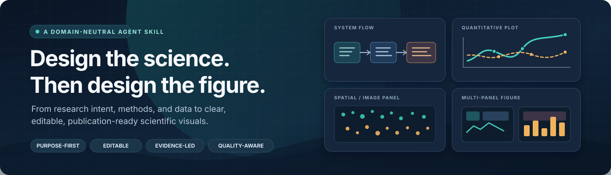
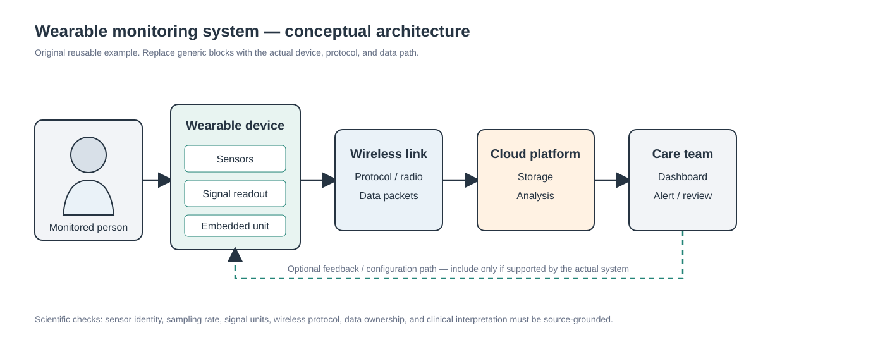
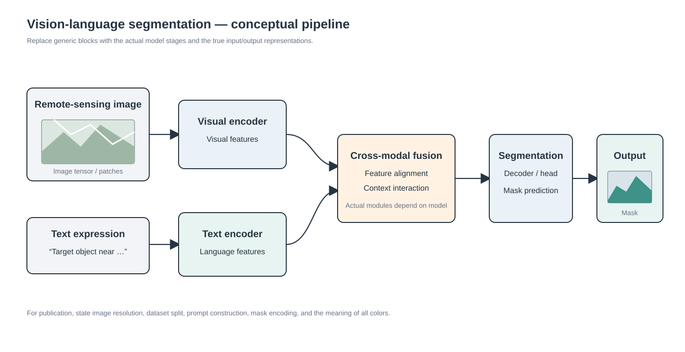
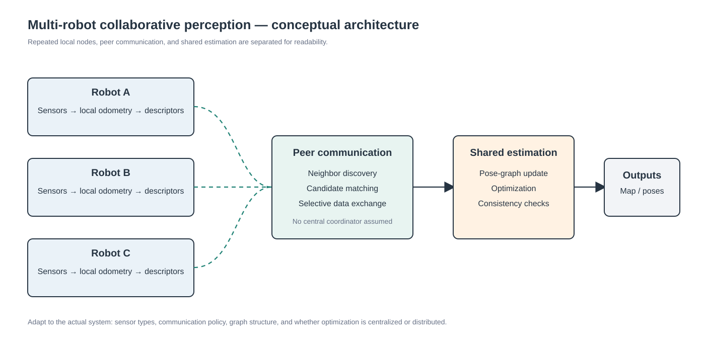
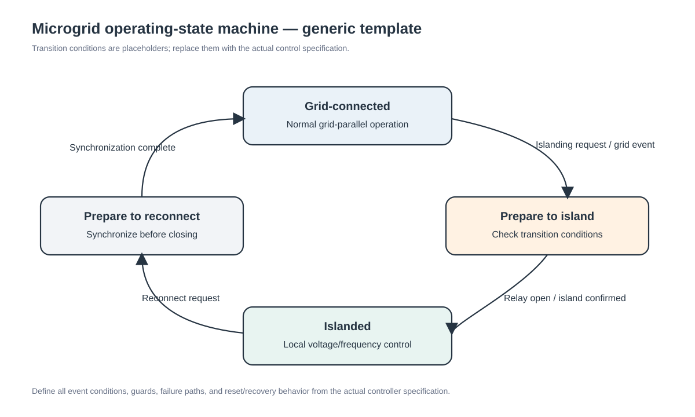
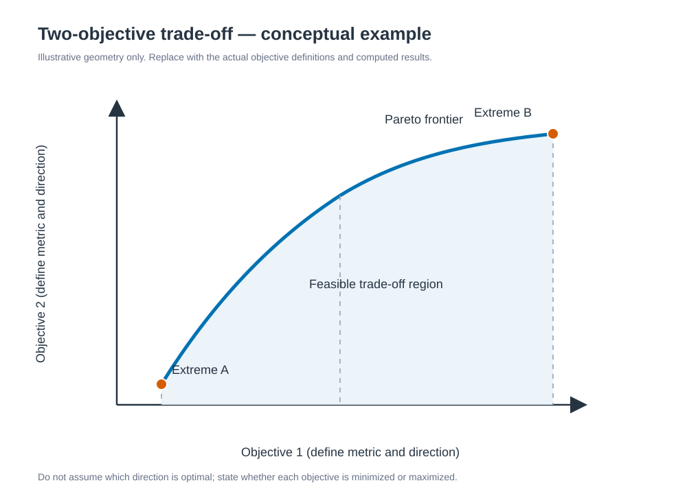
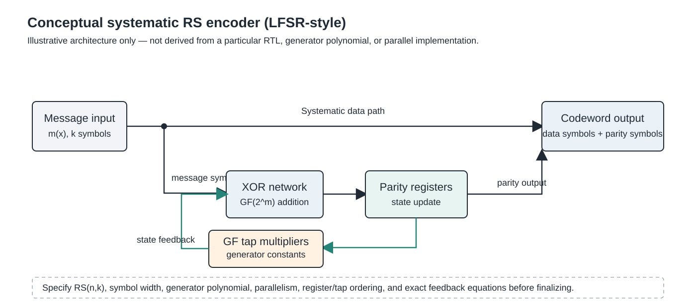

# IEEE-Figure-Skill

<strong>A domain-neutral Agent Skill for publication-ready scientific figures in IEEE-style research.</strong>

Turn scientific intent, methods, and data into clear visual stories — then run a structured quality check before submission.

  
  
  
  

  <a href="#quick-start">Quick start</a> ·
  <a href="#figure-gallery">Explore examples</a> ·
  <a href="#automated-quality-assurance">Quality checks</a> ·
  <a href="#how-it-works">How it works</a>

---

## Not every scientific figure is a block diagram

A good figure is not simply attractive. It helps readers understand a method, compare results, follow a process, or interpret evidence.

IEEE-Figure-Skill is designed for researchers in engineering, computing, physical sciences, and biomedical fields. It first identifies **what the figure needs to communicate**, then selects a suitable visual grammar — rather than forcing every problem into the same style.

<table>
  <tr>
    <td width="50%">
      <h3>🎯 Purpose-first design</h3>
      Choose a visual form that serves the scientific message: architecture, workflow, plot, spatial panel, illustration, or multi-panel composition.
    </td>
    <td width="50%">
      <h3>🧭 Domain-neutral guidance</h3>
      Route across research fields without assuming that hardware diagrams, one color palette, or one layout fits every discipline.
    </td>
  </tr>
  <tr>
    <td width="50%">
      <h3>✏️ Editable by design</h3>
      Prefer reusable vector sources, scripts, and structured templates where practical — not only flattened screenshots.
    </td>
    <td width="50%">
      <h3>🔎 Quality-aware workflow</h3>
      Pair figure creation with checks for layout, resolution, color accessibility, captions, and venue-specific requirements.
    </td>
  </tr>
</table>

## Figure gallery

A few examples of the visual forms the Skill can support. Select any figure to inspect its editable SVG source.

<table>
  <tr>
    <td width="33%" valign="top">
      
      
<strong>Biomedical systems</strong> Wearable sensing, signal processing, wireless transmission, and clinical review.

    </td>
    <td width="33%" valign="top">
      
      
<strong>Remote sensing and AI</strong> Multimodal inputs, feature encoding, fusion, and segmentation output.

    </td>
    <td width="33%" valign="top">
      
      
<strong>Robotics and control</strong> Distributed perception, communication, and shared optimization.

    </td>
  </tr>
  <tr>
    <td width="33%" valign="top">
      
      
<strong>Power systems</strong> Operating states, transitions, and control logic.

    </td>
    <td width="33%" valign="top">
      
      
<strong>Signal processing</strong> Quantitative trade-offs and Pareto-frontier communication.

    </td>
    <td width="33%" valign="top">
      
      
<strong>Computing architectures</strong> Structured datapaths and conceptual encoder organization.

    </td>
  </tr>
</table>

These are original illustrative examples, not reproduced figures from published papers. Conceptual diagrams do not represent measured results unless explicitly stated.

## What it can help you create

| Figure family | Examples |
|---|---|
| **Systems and methods** | System architectures, algorithms, workflows, state machines, sequence diagrams |
| **AI and computation** | Model architectures, data pipelines, computer-vision workflows |
| **Experiments** | Experimental setups, measurement geometries, instrumentation layouts |
| **Quantitative results** | Line/bar/scatter plots, performance comparisons, statistical graphics |
| **Biomedical and imaging** | Microscopy, medical-image panels, spatial omics, remote-sensing panels |
| **Spatial and physical systems** | Maps, robot trajectories, antenna patterns, field distributions |
| **Scientific communication** | Multi-panel figures, tables, mathematical illustrations, conceptual mechanisms |

## How it works

<table>
  <tr>
    <td align="center" width="25%">
      <h3>01</h3>
      <strong>Understand</strong>
      
Identify the scientific question, evidence, audience, and intended message.

    </td>
    <td align="center" width="25%">
      <h3>02</h3>
      <strong>Select</strong>
      
Choose the figure family, visual hierarchy, encoding, and layout.

    </td>
    <td align="center" width="25%">
      <h3>03</h3>
      <strong>Create</strong>
      
Build a clear figure with editable sources and traceable inputs where practical.

    </td>
    <td align="center" width="25%">
      <h3>04</h3>
      <strong>Review</strong>
      
Check clarity, integrity, accessibility, export quality, and venue instructions.

    </td>
  </tr>
</table>

## Quick start

### 1. Add the Skill to your agent

Clone or download this repository:

~~~bash
git clone https://github.com/NRMAO/IEEE-Figure-Skill.git
~~~

Add the repository root folder to the skills directory supported by your AI agent. Keep <code>SKILL.md</code> together with the <code>references/</code>, <code>templates/</code>, and <code>examples/</code> folders so the agent can access the complete guidance.

Then ask your agent to use **IEEE-Figure-Skill** when creating, revising, or reviewing a scientific figure.

### 2. Try a prompt

~~~text
Use IEEE-Figure-Skill to turn this method description into a clear,
editable system architecture. Preserve the technical meaning and
make every signal path and module relationship explicit.
~~~

More ideas:

- “Analyze these reference figures. Separate recurring design patterns from your own recommendations.”
- “Create a publication-ready multi-panel figure from these CSV files. Preserve all values, units, and uncertainty.”
- “Arrange these microscopy panels with consistent scale bars, panel labels, and image provenance.”
- “Turn this robotics pipeline into a system overview and a separate state diagram.”
- “Inspect this RTL and draw only the data flow supported by the implementation.”
- “Review this figure for text overflow, ambiguous colors, missing legend definitions, and export problems.”

## Automated quality assurance

Creating the figure is only half the job. The repository also includes a runnable preflight tool for measurable publication-readiness issues.

| Check | What it screens |
|---|---|
| **SVG layout** | Text extending beyond the canvas, using Chromium-rendered text bounds |
| **PDF layout** | Text outside the page and text below the configurable size threshold |
| **Raster quality** | PNG/TIFF effective print resolution and PDF embedded-image resolution |
| **Typography** | PDF font embedding |
| **Color accessibility** | Perceptual color distance, grayscale separation, and optional color-vision-deficiency simulations |
| **Caption metadata** | Figure number, panel labels, declared abbreviations, symbols, color meanings, and source credit |
| **Venue profile** | Configurable file formats, physical dimensions, and resolution thresholds |

### Run the checker

Python 3.10 or newer is required.

~~~bash
python -m pip install -e ".[browser,test]"
python -m playwright install chromium

python tools/figure_preflight.py \
  --manifest manifests/figure-manifest.example.json \
  --profile profiles/ieee-baseline.json \
  --report build/preflight.json
~~~

The JSON report records errors, warnings, skipped checks, and measured metrics. Add <code>--strict</code> if warnings should also produce a failing exit code.

**Important:** the default profile is a general IEEE screening baseline, not a universal acceptance guarantee. Color-distance and text-contrast thresholds are configurable heuristics, not official IEEE pass/fail rules. Automated checks cannot establish scientific validity, caption meaning, data provenance, permissions, or guaranteed journal acceptance. Always inspect the final figure and check the current instructions of the target journal or conference.

See the full guide: [Automated Figure Quality Assurance](docs/automated-quality-assurance.md).

## Research domains

The Skill includes domain adapters and visual guidance for:

- Circuits, electronics, and computing
- Communications and signal processing
- Artificial intelligence and computer vision
- Biomedical engineering and life sciences
- Robotics, automation, and control
- Power systems and energy
- Antennas and electromagnetics
- Remote sensing and geospatial science
- Materials and physical sciences

These are supported starting points, not a claim that every subfield has already been comprehensively surveyed.

## Repository map

| Path | Purpose |
|---|---|
| <code>SKILL.md</code> | Main domain-neutral instructions for the agent |
| <code>references/</code> | Publication guidance, domain routing, figure types, color, typography, ethics, and review checklists |
| <code>templates/</code> | Reusable architecture, flowchart, timing, and plotting templates |
| <code>examples/</code> | Original examples across research domains |
| <code>tools/figure_preflight.py</code> | Automated figure preflight command-line tool |
| <code>manifests/</code> | Example metadata sidecar for figure and caption checks |
| <code>profiles/</code> | Configurable IEEE and venue-specific screening profiles |
| <code>docs/</code> | Detailed usage, setup, and quality-assurance documentation |
| <code>tests/</code> | Automated tests |
| <code>.github/workflows/</code> | Continuous integration for tests and example preflight |

## Design principles

- **Scientific meaning before decoration.**
- **Figure type before color palette.**
- **Evidence before inference.**
- **Editable source before flattened artwork**, where practical.
- **Accessibility and reproducibility are part of figure quality.**
- **Target venue instructions before generic defaults.**

There is no single universal IEEE figure style. Different research communities use different visual grammars, and each journal or conference may define its own artwork requirements.

## Publication resources

Always verify the current instructions for the target publication and article type.

- [IEEE Author Center — Create Graphics for Your Article](https://journals.ieeeauthorcenter.ieee.org/create-your-ieee-journal-article/create-graphics-for-your-article/)
- [IEEE Author Center — Resolution and Size](https://journals.ieeeauthorcenter.ieee.org/create-your-ieee-journal-article/create-graphics-for-your-article/resolution-and-size/)
- [IEEE Author Center — File Formatting](https://journals.ieeeauthorcenter.ieee.org/create-your-ieee-journal-article/create-graphics-for-your-article/file-formatting/)
- [Proceedings of the IEEE — Guidelines for Figures and Tables](https://proceedingsoftheieee.ieee.org/resources/guidelines-for-figures-and-tables/)

## Research integrity and copyright

The repository focuses on bibliographic references, high-level design observations, original examples, and editable templates. It does not redistribute source papers or reproduce their copyrighted figures.

Use supplied data faithfully. Do not invent measurements, omit inconvenient results, alter image evidence deceptively, or imply that a conceptual illustration is an experimentally validated result. Check permissions and attribution requirements before adapting third-party material.

The original HBM/RS examples from the first version remain optional hardware-domain examples; they no longer define the Skill's default scope.

## Contributing

Contributions that make the Skill more useful across research communities are welcome. Useful additions include:

- New domain adapters grounded in representative literature
- Original, editable examples with clear provenance
- Venue-specific profiles backed by official author instructions
- Tests for new preflight checks and edge cases
- Documentation improvements and reproducible plotting templates

When adding publication requirements, include the official source and the date it was checked.

---

**Build figures that make the science easier to understand.**

[Back to top](#ieee-figure-skill) · [Open an issue](https://github.com/NRMAO/IEEE-Figure-Skill/issues) · [Browse the source](https://github.com/NRMAO/IEEE-Figure-Skill)

