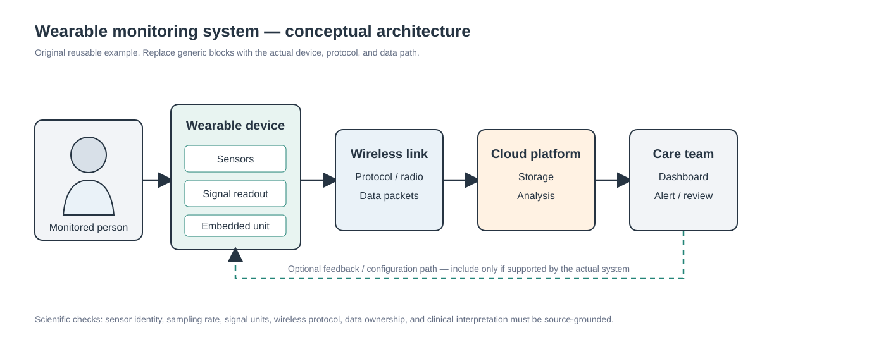
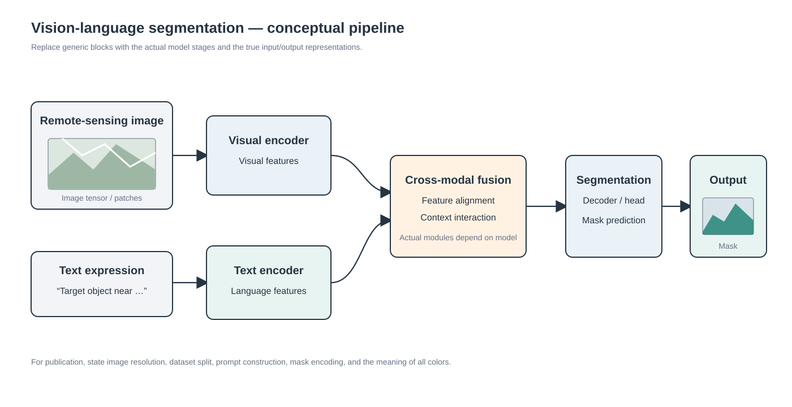
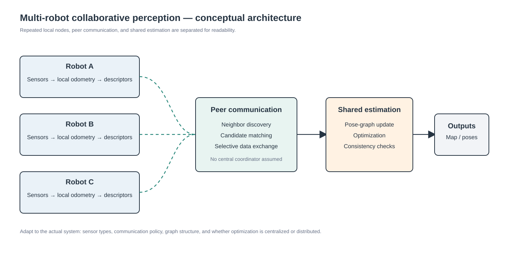
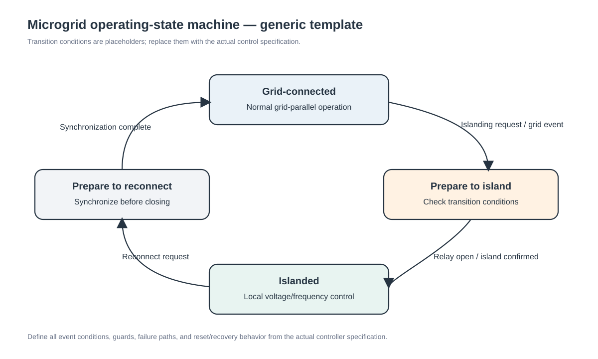
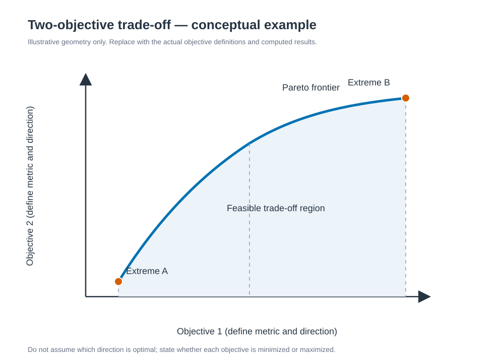
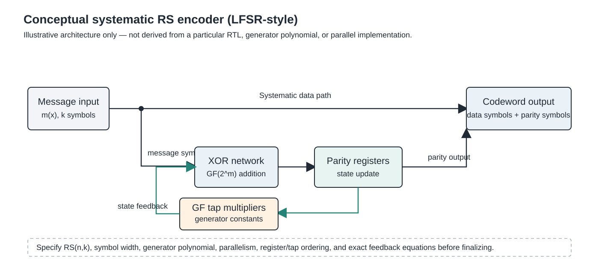

# IEEE-Figure-Skill

🌐 <strong>语言：</strong> <a href="README.md">English</a> | 简体中文

<strong>面向 IEEE 风格科研论文的跨领域智能绘图 Skill。</strong>

将科研目的、方法与数据转化为清晰、可编辑的科学图形，并在投稿前进行系统化质量检查。

  
  
  
  

  <a href="#快速开始">快速开始</a> ·
  <a href="#绘图案例">浏览案例</a> ·
  <a href="#自动化质量检查">质量检查</a> ·
  <a href="#工作流程">工作流程</a>

---

## 并不是所有科研图片都是框图

一张优秀的科研图片，不只是看起来漂亮。它应该帮助读者理解研究方法、比较实验结果、追踪处理流程，或者解读科学证据。

IEEE-Figure-Skill 面向工程、计算机、物理科学和生物医学等领域的研究人员。它会先判断**这张图需要传达什么科学信息**，再选择合适的视觉表达方式，而不是把所有问题都套进同一种绘图风格。

<table>
  <tr>
    <td width="50%">
      <h3>🎯 以科学目的为先</h3>
      根据科学信息选择合适的图形形式，例如系统架构图、流程图、数据图表、空间图像、科学示意图或多分图组合。
    </td>
    <td width="50%">
      <h3>🧭 跨学科适用</h3>
      面向不同研究领域提供绘图指导，不预设硬件框图、某一种配色或某一种版式适用于所有学科。
    </td>
  </tr>
  <tr>
    <td width="50%">
      <h3>✏️ 优先提供可编辑文件</h3>
      在条件允许时，优先生成可复用的矢量源文件、绘图脚本和结构化模板，而不只是不可编辑的截图。
    </td>
    <td width="50%">
      <h3>🔎 将质量检查纳入工作流程</h3>
      在绘图后检查布局、分辨率、颜色可访问性、图注以及目标期刊或会议的具体要求。
    </td>
  </tr>
</table>

## 绘图案例

以下展示了 Skill 可以支持的部分图形类型。点击任意图片，可以查看对应的可编辑 SVG（可缩放矢量图形）源文件。

<table>
  <tr>
    <td width="33%" valign="top">
      
      
<strong>生物医学系统</strong> 可穿戴传感、信号处理、无线传输与临床评估。

    </td>
    <td width="33%" valign="top">
      
      
<strong>遥感与人工智能</strong> 多模态输入、特征编码、信息融合与分割输出。

    </td>
    <td width="33%" valign="top">
      
      
<strong>机器人与控制</strong> 分布式感知、通信与协同优化。

    </td>
  </tr>
  <tr>
    <td width="33%" valign="top">
      
      
<strong>电力系统</strong> 运行状态、状态转换与控制逻辑。

    </td>
    <td width="33%" valign="top">
      
      
<strong>信号处理</strong> 定量权衡关系与帕累托前沿展示。

    </td>
    <td width="33%" valign="top">
      
      
<strong>计算架构</strong> 结构化数据通路与编码器组织方式。

    </td>
  </tr>
</table>

以上均为原创示意案例，并非直接复制已发表论文中的图片。除非特别说明，概念示意图不代表真实测量结果。

## 它可以帮助你绘制什么？

| 图形类别 | 典型应用 |
|---|---|
| **系统与方法** | 系统架构图、算法图、工作流程图、状态机、时序交互图 |
| **人工智能与计算** | 模型架构、数据处理管线、计算机视觉流程 |
| **实验设计** | 实验装置、测量几何关系、仪器布局 |
| **定量结果** | 折线图、柱状图、散点图、性能对比图、统计图 |
| **生物医学与成像** | 显微图像、医学影像、多重空间组学、遥感图像 |
| **空间与物理系统** | 地图、机器人轨迹、天线方向图、物理场分布 |
| **科研信息表达** | 多分图、表格、数学示意图、概念机制图 |

## 工作流程

<table>
  <tr>
    <td align="center" width="25%">
      <h3>01</h3>
      <strong>理解需求</strong>
      
识别科学问题、已有证据、目标读者和图片需要传达的核心信息。

    </td>
    <td align="center" width="25%">
      <h3>02</h3>
      <strong>选择形式</strong>
      
确定图形类别、视觉层级、信息编码方式和版面布局。

    </td>
    <td align="center" width="25%">
      <h3>03</h3>
      <strong>生成图形</strong>
      
在条件允许时提供清晰的图形、可编辑源文件和可追溯的数据输入。

    </td>
    <td align="center" width="25%">
      <h3>04</h3>
      <strong>质量审查</strong>
      
检查可读性、科研诚信、颜色可访问性、导出质量和投稿要求。

    </td>
  </tr>
</table>

## 快速开始

### 1. 将 Skill 添加到你的 AI Agent

克隆仓库或下载 ZIP 压缩包：

~~~bash
git clone https://github.com/NRMAO/IEEE-Figure-Skill.git
~~~

将仓库根目录放入你的 AI Agent 所支持的 Skills 目录。请保留 <code>SKILL.md</code>，以及 <code>references/</code>、<code>templates/</code> 和 <code>examples/</code> 等文件夹，使 Agent 能够读取完整的绘图规范、模板和案例。

完成后，在创建、修改或审查科研图片时，告诉你的 AI Agent 使用 **IEEE-Figure-Skill** 即可。

### 2. 尝试第一个 Prompt

~~~text
请使用 IEEE-Figure-Skill，将下面的方法描述转化为清晰、可编辑的系统架构图。
请保留原始技术含义，并明确展示每个信号路径以及各模块之间的关系。
~~~

你还可以尝试：

- “分析这些参考论文图片，区分其中反复出现的设计规律和你自己的改进建议。”
- “根据这些 CSV 数据生成适合论文投稿的多分图。请保留所有原始数值、单位和不确定性信息。”
- “将这些显微图像整理成统一的多分图，确保比例尺、分图标签和图像来源信息一致。”
- “将这个机器人系统流程分别绘制成系统总览图和状态机图。”
- “阅读这份 RTL 代码，只绘制代码实际支持的数据流关系，不要自行推断不存在的模块。”
- “检查这张图片是否存在文字溢出、颜色难以区分、图例定义缺失或导出质量问题。”

## 自动化质量检查

生成图片只是工作的一半。本仓库还提供了可以实际运行的图片预检工具，用于发现能够通过程序测量的投稿质量问题。

| 检查项目 | 具体检查内容 |
|---|---|
| **SVG 布局** | 使用 Chromium 浏览器实际测量文字边界，检查文字是否超出画布 |
| **PDF 布局** | 检查文字是否超出页面边界，以及字号是否低于可配置阈值 |
| **位图质量** | 检查 PNG/TIFF 的有效打印分辨率，以及 PDF 中嵌入图片的分辨率 |
| **字体** | 检查 PDF 字体是否嵌入 |
| **颜色可访问性** | 检查颜色感知距离、灰度区分度，以及可选的色觉缺陷模拟结果 |
| **图注元数据** | 检查图号、分图标签、已声明的缩写、符号、颜色含义和来源标注 |
| **期刊规范配置** | 通过配置文件设置允许的格式、实际尺寸和分辨率阈值 |

### 运行检查程序

需要 Python 3.10 或更高版本。

~~~bash
python -m pip install -e ".[browser,test]"
python -m playwright install chromium

python tools/figure_preflight.py \
  --manifest manifests/figure-manifest.example.json \
  --profile profiles/ieee-baseline.json \
  --report build/preflight.json
~~~

程序会生成 JSON（JavaScript 对象表示法）检查报告，记录错误、警告、跳过的检查项目和测量指标。如果希望警告也导致程序返回失败，可以增加 <code>--strict</code> 参数。

**重要说明：** 默认配置只是 IEEE 通用预检基线，并不保证满足所有 IEEE 期刊或会议的要求。颜色距离和文字对比度阈值属于可配置的启发式规则，并非 IEEE 官方的统一合格标准。自动化检查也无法独立判断科研结论是否正确、图注语义是否准确、数据来源是否可靠、图片使用是否获得授权，或保证论文一定被期刊接收。请始终人工检查最终图片，并核对目标期刊或会议的最新投稿说明。

完整说明请参阅：[自动化科研绘图质量检查指南](docs/automated-quality-assurance.md)。

## 支持的研究领域

本 Skill 已提供以下领域的绘图适配指导：

- 电路、电子与计算机工程
- 通信与信号处理
- 人工智能与计算机视觉
- 生物医学工程与生命科学
- 机器人、自动化与控制
- 电力系统与能源
- 天线与电磁学
- 遥感与地理空间科学
- 材料与物理科学

这些是当前支持的起点，并不意味着已经对每个细分领域的全部绘图规范进行了穷尽式调研。

## 仓库目录

| 路径 | 用途 |
|---|---|
| <code>SKILL.md</code> | 提供给 AI Agent 使用的跨领域核心指令 |
| <code>references/</code> | 投稿指导、领域适配、图形类型、颜色、字体、科研诚信和检查清单 |
| <code>templates/</code> | 可复用的架构图、流程图、时序图和数据绘图模板 |
| <code>examples/</code> | 来自多个研究领域的原创示例 |
| <code>tools/figure_preflight.py</code> | 自动化科研图片预检命令行工具 |
| <code>manifests/</code> | 图片及图注检查所需的示例元数据文件 |
| <code>profiles/</code> | IEEE 通用及特定期刊的可配置检查规范 |
| <code>docs/</code> | 详细使用说明、安装指南和质量检查文档 |
| <code>tests/</code> | 自动化测试 |
| <code>.github/workflows/</code> | 自动运行测试和示例图片预检的持续集成配置 |

## 核心设计原则

- **科学含义优先于装饰。**
- **先确定图形类型，再选择配色。**
- **以证据为依据，而不是凭空推断。**
- **在条件允许时，优先保留可编辑源文件，而不是只提供扁平化图片。**
- **将可访问性和可复现性纳入图片质量评价。**
- **目标期刊的投稿要求优先于通用默认规范。**

不存在一种适用于所有领域的统一 IEEE 绘图风格。不同研究社区有各自的视觉表达习惯，不同期刊和会议也可能制定不同的图片规范。

## IEEE 投稿参考资料

请始终核对目标期刊、会议和文章类型对应的最新投稿要求。

- [IEEE Author Center — 论文图片制作指南](https://journals.ieeeauthorcenter.ieee.org/create-your-ieee-journal-article/create-graphics-for-your-article/)
- [IEEE Author Center — 图片分辨率与尺寸](https://journals.ieeeauthorcenter.ieee.org/create-your-ieee-journal-article/create-graphics-for-your-article/resolution-and-size/)
- [IEEE Author Center — 文件格式要求](https://journals.ieeeauthorcenter.ieee.org/create-your-ieee-journal-article/create-graphics-for-your-article/file-formatting/)
- [Proceedings of the IEEE — 图片与表格指南](https://proceedingsoftheieee.ieee.org/resources/guidelines-for-figures-and-tables/)

## 科研诚信与版权

本仓库主要保存文献引用、较高层次的设计规律总结、原创示例和可编辑模板，不重新分发原始论文，也不复制受版权保护的论文图片。

请忠实使用用户提供的数据。不要编造实验数值、删除不利结果、以误导性的方式修改图像证据，也不要将概念示意图描述为已经通过实验验证的结果。改编第三方材料前，请确认相应的版权许可和署名要求。

第一版中面向 HBM（高带宽存储器）和 RS（里德–所罗门纠错码）的示例仍作为可选的硬件领域案例保留，但它们不再决定整个 Skill 的默认适用范围。

## 参与贡献

欢迎提交能够提升本 Skill 跨学科适用性的贡献，例如：

- 基于代表性文献新增研究领域适配规范
- 提供具有清晰来源说明的原创、可编辑示例
- 根据期刊官方投稿说明建立专用配置文件
- 为新的自动化检查功能及边界情况增加测试
- 改进文档和可复现绘图模板

新增期刊投稿要求时，请同时提供官方来源和核对日期。

---

**让科研图形更清晰，让科学发现更容易被理解。**

[返回顶部](#ieee-figure-skill) · [提交问题](https://github.com/NRMAO/IEEE-Figure-Skill/issues) · [浏览源代码](https://github.com/NRMAO/IEEE-Figure-Skill)

🌐 <a href="README.md">English</a> | 简体中文

